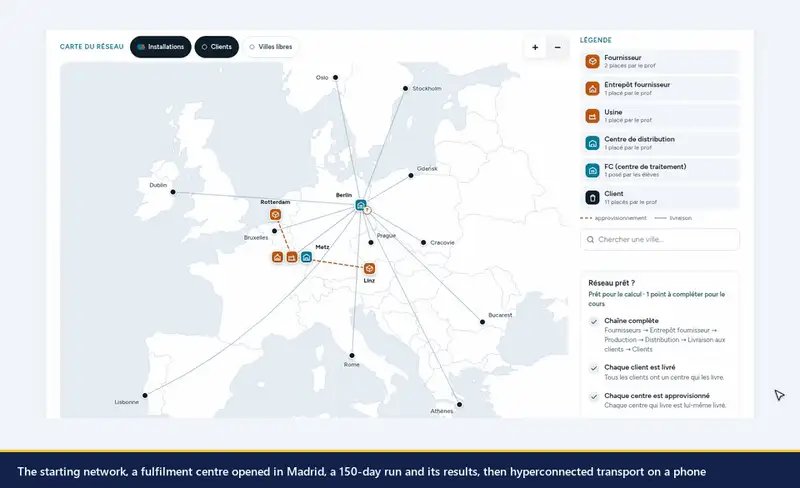
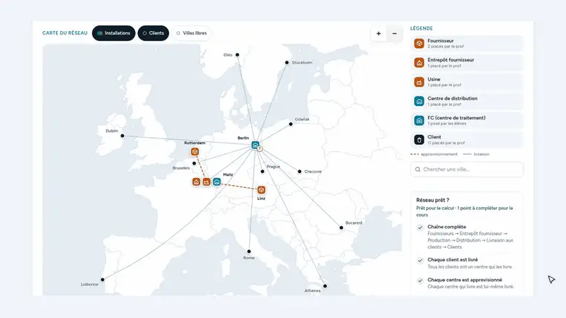
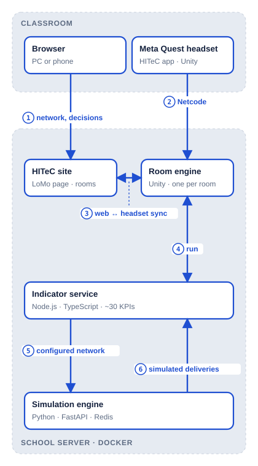
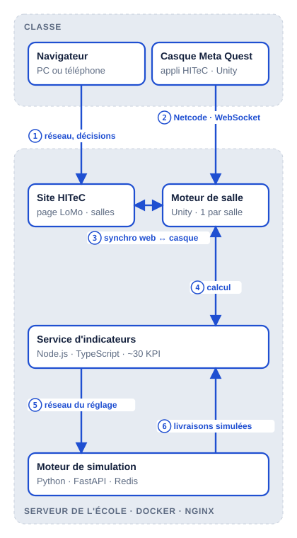

[English](README.md) · **Français**

# LoMo

**Les étudiants conçoivent un réseau logistique européen, le simulent, puis le refont avec les options de l'Internet physique et mesurent l'écart.** Un module de cours de la plateforme HITeC, joué ensemble sur ordinateur, téléphone ou casque Meta Quest.

Version française

## Utilisation

- **Salle.** Le professeur ouvre une salle et charge un scénario : fournisseurs, une usine, un centre de distribution, des clients dans toute l'Europe, une année en trois saisons.
- **Postes.** Chaque étudiant prend une installation. Un changement fait sur n'importe quel appareil s'affiche chez tous.
- **Décisions.** Les étudiants ouvrent des centres de traitement sur la carte (taille S, M ou L), puis règlent étagères, camions et lignes de production saison par saison. Une liste bloque le calcul tant qu'il manque quelque chose.
- **Simulation.** Le professeur lance 150 jours de livraisons. Les résultats tiennent en quatre familles (efficience, carbone, service, coût), puis installation par installation.
- **Cinq réglages.** Le réseau de base, puis quatre réglages de l'Internet physique : transport hyperconnecté, centres de distribution et de traitement ouverts, fabrication distribuée, usines ouvertes. Chacun est comparé au réseau de base.

## Architecture

Diagramme en français

## État

- **Juin 2026.** Première version utilisée en cours. Les étudiants ont refusé le casque : le cours a été refait d'abord pour le web, casque en option.
- **Octobre 2026.** Refait dans HITeC, web et casque dans la même salle. Recette finale pas encore faite.
- **Aujourd'hui.** En pause depuis le 1er novembre 2026, pas en production. L'instance de test du serveur de l'école (Docker, réseau de l'école seulement) est arrêtée.
- **Code.** Privé, comme les scénarios et le contenu du cours. La vidéo utilise des comptes de démonstration et un scénario de test.

---

**Anthony Hunt** · [ingevision.cloud](https://ingevision.cloud/?p=lomo) · [LinkedIn](https://www.linkedin.com/in/anthony-hunt-3948a9196) · [GitHub](https://github.com/anthohunt)
