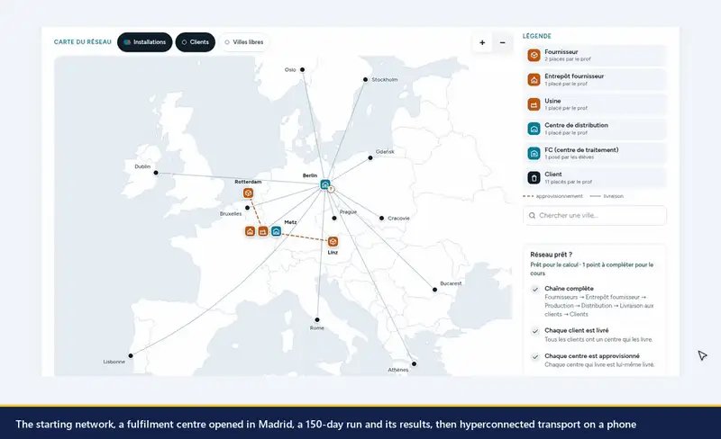
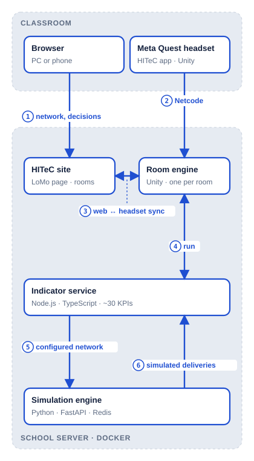
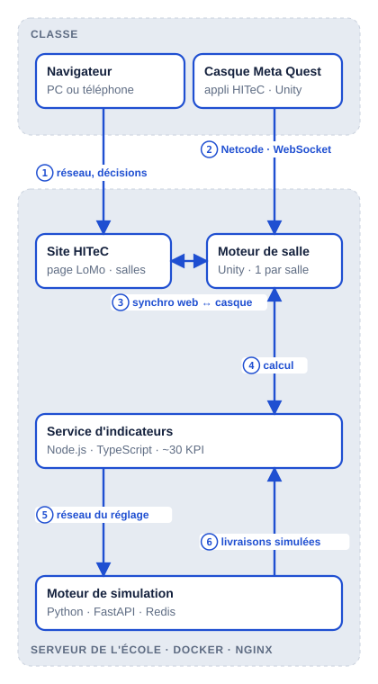

**English** · [Français](README.fr.md)

# LoMo

**Students design a European supply chain network, simulate it, then rebuild it with Physical Internet options and measure the gap.** A course module of the HITeC platform, played together on a computer, a phone or a Meta Quest headset.

French version

*French interface, English captions; the English video has no sound (the narration is in French). [Full video (2:17)](https://drive.google.com/file/d/1oU39vlcpxEfFu0RXz3ERBBnLPYjn2RT0/view)*

## Using it

- **Room.** The teacher opens a room and loads a scenario: suppliers, a factory, a distribution centre, customers across Europe, a year in three seasons.
- **Seats.** Each student takes one facility. A change made on any device shows up for everyone.
- **Decisions.** Students open fulfilment centres on the map (size S, M or L), then set shelves, trucks and production lines season by season. A checklist holds the run until nothing is missing.
- **Simulation.** The teacher runs 150 days of deliveries. Results come in four families (efficiency, carbon, service, cost), then facility by facility.
- **Five settings.** Baseline, then four Physical Internet settings: hyperconnected transport, open distribution and fulfilment centres, distributed manufacturing, open factories. Each one is compared with the baseline.

## Architecture

French version

## Status

- **June 2026.** First version used in class. The students turned down the headset, so the course was rebuilt web first, headset optional.
- **October 2026.** Rebuilt inside HITeC, web and headset in the same room. Final acceptance test not run yet.
- **Now.** On hold since 1 November 2026, not in production. The test instance on the school server (Docker, school network only) is stopped.
- **Code.** Private, like the scenarios and course content. The video uses demo accounts and a test scenario.

---

**Anthony Hunt** · [ingevision.cloud](https://ingevision.cloud/?lang=en&p=lomo) · [LinkedIn](https://www.linkedin.com/in/anthony-hunt-3948a9196) · [GitHub](https://github.com/anthohunt)
