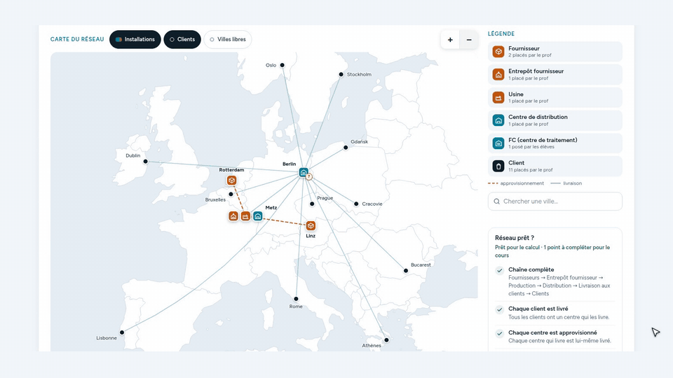

**English** · [Français](README.fr.md)

# LoMo

**Students design a European supply chain network, simulate it, then rebuild it with Physical Internet options and measure the gap.** A course module of the HITeC platform, played together on a computer, a phone or a Meta Quest headset.

*Map, a new fulfilment centre, a 150-day run, then hyperconnected transport seen on a phone. [Full video (2:17, French narration)](https://drive.google.com/file/d/1oU39vlcpxEfFu0RXz3ERBBnLPYjn2RT0/view)*

## Using it

- **Room.** The teacher opens a room and loads a scenario: suppliers, a factory, a distribution centre, customers across Europe, a year in three seasons.
- **Seats.** Each student takes one facility, from a browser, a phone or the headset. A change made anywhere shows up for everyone.
- **Decisions.** Students open fulfilment centres on the map (size S, M or L), then set shelves, trucks and production lines season by season. A checklist holds the run until nothing is missing.
- **Simulation.** The teacher runs 150 days of deliveries. Results come in four families (efficiency, carbon, service, cost), then facility by facility.
- **Five settings.** Baseline, then four Physical Internet settings: hyperconnected transport, open distribution and fulfilment centres, distributed manufacturing, open factories. Each one is compared with the baseline.

## Architecture

## Status

- **June 2026.** First version used in class. The students turned down the headset, so the course was rebuilt web first, headset optional.
- **October 2026.** Second version inside HITeC: 15 steps, each validated by an independent reviewer.
- **Now.** On hold since 1 November 2026, not in production. The test instance on the school server (Docker, school network only) is stopped.
- **Stack.** Unity (headset app, one dedicated server per room, Netcode for GameObjects), Node.js and TypeScript, Python with FastAPI and Redis, nginx.

---

**Anthony Hunt** · [ingevision.cloud](https://ingevision.cloud/?lang=en&p=lomo) · [LinkedIn](https://www.linkedin.com/in/anthony-hunt-3948a9196) · [GitHub](https://github.com/anthohunt)

The code, scenarios and course content stay private. The video uses demo accounts and a test scenario.
